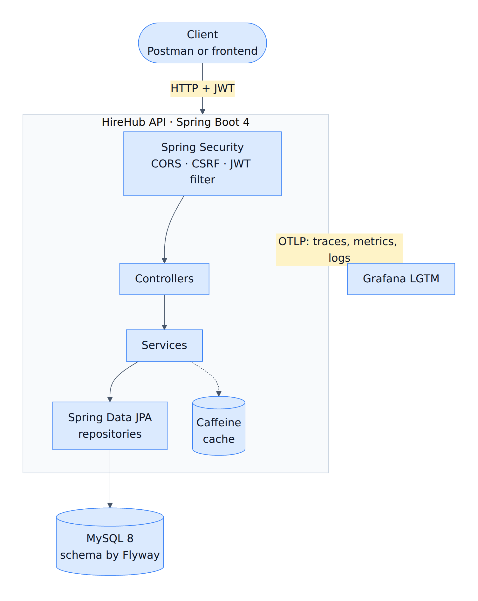
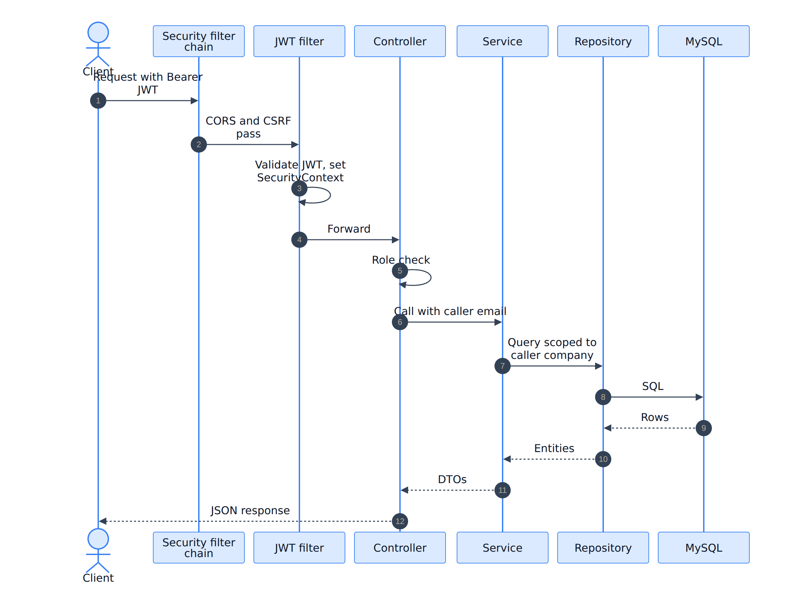
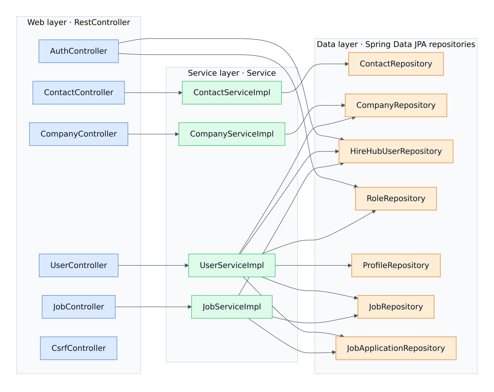
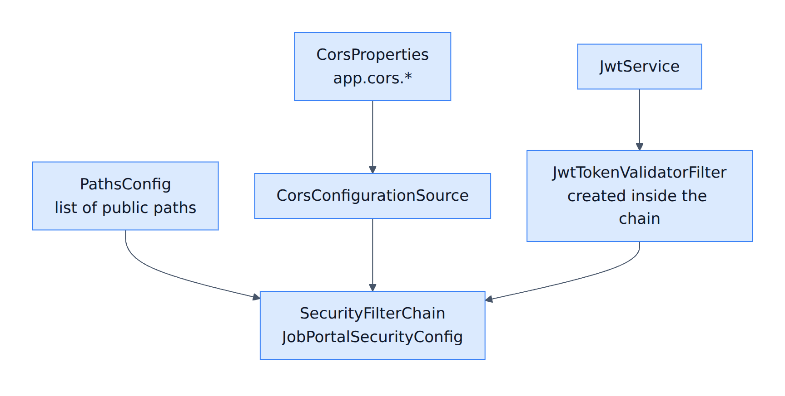
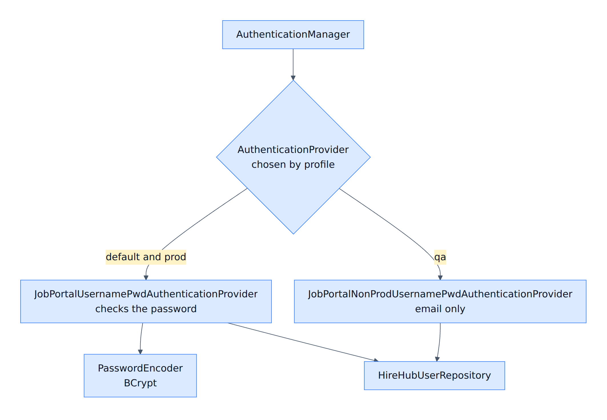
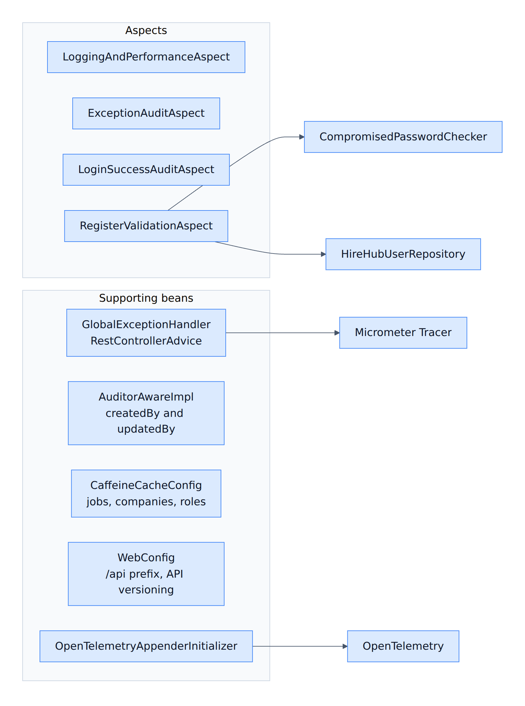
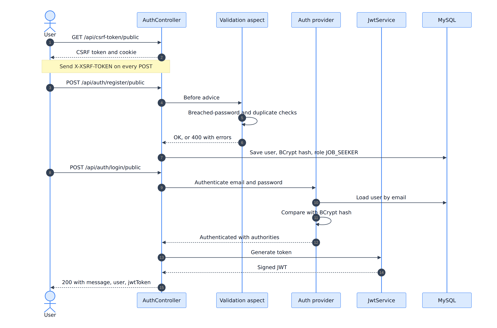
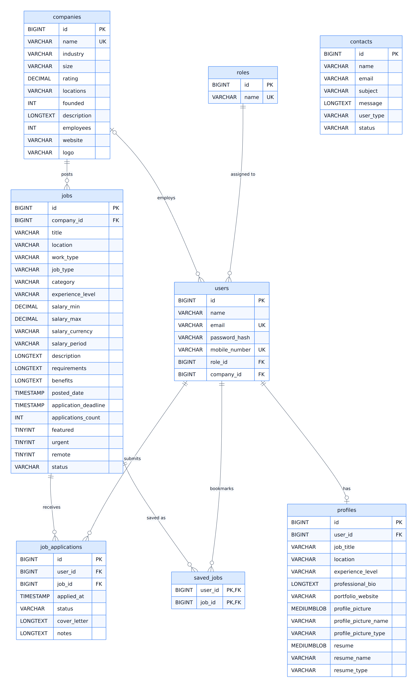

<div align="center">

# HireHub

**A job-portal REST API built with Spring Boot 4: role-based JWT security, company-scoped authorization, Flyway migrations, caching and end-to-end observability.**


</div>


## Table of contents

1. [Overview](#overview)
2. [Highlights](#highlights)
3. [Tech stack](#tech-stack)
4. [Architecture](#architecture)
5. [Security](#security)
6. [Database design](#database-design)
7. [API reference](#api-reference)
8. [Postman collection](#postman-collection)
9. [Getting started](#getting-started)
10. [Profiles and configuration](#profiles-and-configuration)
11. [Observability](#observability)
12. [Performance](#performance)
13. [Project structure](#project-structure)
14. [Design decisions](#design-decisions)
15. [Author](#author)

---

## Overview

HireHub is the backend of a job portal with three kinds of users:

| Role | What they can do |
|---|---|
| **Job seeker** | Register, build a profile (picture and resume upload), save jobs, apply to and withdraw from jobs, track application status |
| **Employer** | Post jobs for their company, change a job's status (`DRAFT`, `ACTIVE`, `CLOSED`), review applicants and move them through the hiring pipeline (`PENDING` → `IN_REVIEW` → `INTERVIEW` → `HIRED` / `REJECTED`) |
| **Admin** | Manage companies, promote users to employer and assign them to a company, read and close contact messages |

Anyone (no login) can browse companies with their jobs and send a contact message.

## Highlights

- **Stateless JWT authentication** with a custom `AuthenticationProvider`, BCrypt password hashing, and a check of new passwords against the *Have I Been Pwned* breach database.
- **Authorization at two levels:** role checks with `@PreAuthorize`, plus *object-level* checks. An employer can only read and update applications for jobs that belong to their own company.
- **Database changes under version control** with Flyway. Hibernate only *validates* the schema (`ddl-auto=validate`). Demo data and demo users live in a separate migration folder that production never loads.
- **Environment profiles** (`default`, `qa`, `prod`) with a shared base file plus small override files.
- **Caffeine caching** with a separate TTL and size per cache (`jobs`, `companies`, `roles`).
- **JPA auditing:** every row records who created and last changed it.
- **API versioning** through the `Accept` media type (`application/vnd.hirehub+json;v=1.0`).
- **Observability:** Actuator, Micrometer tracing and OpenTelemetry (traces, metrics, logs) shipped to a local Grafana stack. Every error response carries a `traceId`.
- **Global exception handling** that returns one consistent JSON error shape.
- **Documented API:** every controller is described with OpenAPI annotations, so Swagger UI shows a summary for each endpoint.

## Tech stack

| Area | Technology |
|---|---|
| Language and framework | Java 25, Spring Boot 4.1.1, Spring MVC |
| Security | Spring Security, JWT (jjwt), BCrypt, Have I Been Pwned password checker |
| Persistence | Spring Data JPA / Hibernate, MySQL 8, Flyway |
| Caching | Spring Cache with Caffeine |
| API documentation | springdoc OpenAPI (Swagger UI) |
| Observability | Spring Boot Actuator, Micrometer Tracing, OpenTelemetry, Grafana LGTM |
| Build and run | Maven Wrapper, Docker Compose, Lombok |

## Architecture

> The diagrams below are images, so they display in any viewer. Their editable [Mermaid](https://mermaid.js.org) sources are in [`docs/diagrams`](docs/diagrams).

### System overview

<p align="center"></p>

### Life of a request

<p align="center"></p>

### Bean map: web, service and data layers

Every controller depends on a service interface, and every service on the repositories it needs. `AuthController` talks to the user and role repositories directly.

<p align="center"></p>

### Bean map: security filter chain

`JobPortalSecurityConfig` also provides the `CorsConfigurationSource`, `PasswordEncoder` (BCrypt), `AuthenticationManager` and `CompromisedPasswordChecker` (Have I Been Pwned) beans.

<p align="center"></p>

### Bean map: authentication

Exactly one provider is active, chosen by the Spring profile.

<p align="center"></p>

### Bean map: cross-cutting concerns

<p align="center"></p>

| Group | Beans |
|---|---|
| Controllers (6) | `AuthController`, `CompanyController`, `ContactController`, `UserController`, `JobController`, `CsrfController` |
| Services (4) | `CompanyServiceImpl`, `ContactServiceImpl`, `UserServiceImpl`, `JobServiceImpl` |
| Repositories (7) | Company, Contact, HireHubUser, Job, JobApplication, Profile, Role |
| Security | `JobPortalSecurityConfig`, `PathsConfig`, `JwtService`, `CorsProperties`, two profile-based authentication providers |
| Cross-cutting | 4 aspects, `GlobalExceptionHandler`, `AuditorAwareImpl`, `CaffeineCacheConfig`, `WebConfig`, `OpenTelemetryAppenderInitializer` |

## Security

### Authentication flow

<p align="center"></p>

### Who can call what

| Path group | Access |
|---|---|
| `/api/auth/*/public`, `/api/companies/public`, `/api/contacts/public`, `/api/csrf-token/public`, Swagger UI, `/jobportal/actuator/health` | Public |
| `/jobportal/actuator/**` (everything except health) | `ROLE_ADMIN` |
| `/api/jobs/**` | `ROLE_EMPLOYER` |
| `/api/users/*/jobseeker`-style endpoints (profile, saved jobs, applications) | `ROLE_JOB_SEEKER` |
| Admin endpoints (companies, contacts, user management) | `ROLE_ADMIN` |
| Any other path | Denied |

Details worth knowing:

- **JWT:** signed with an HMAC key from `JWT_SECRET` (the app refuses to start if it is shorter than 32 bytes). Claims: issuer, subject (email), name, email and roles. Default lifetime: 24 hours (`JWT_EXPIRATION_MS`).
- **CSRF:** enabled with a cookie token. Send the token from `GET /api/csrf-token/public` in the `X-XSRF-TOKEN` header on every `POST`, `PUT`, `PATCH` and `DELETE`.
- **Passwords:** hashed with BCrypt. New passwords are checked against *Have I Been Pwned* (only a hash prefix leaves the app).
- **Error shape for security failures:** `401 {"error":"Unauthorized",...}` and `403 {"error":"Access Denied",...}`.

## Database design

<p align="center"></p>

**Notes**

- Every table except `saved_jobs` also has the audit columns `created_at`, `created_by`, `updated_at`, `updated_by`. The auditor is the signed-in user's email.
- `job_applications` has a unique constraint on `(user_id, job_id)`, so a user can apply to a job only once.
- Deleting a company deletes its jobs and, through them, applications and saved jobs. Deleting a company sets `users.company_id` to `NULL`.
- `users.email` and `users.mobile_number` are unique.

### Flyway migrations

| Migration | Location | Purpose | Loaded in |
|---|---|---|---|
| `V1__init_schema.sql` | `db/migration` | All tables, keys and constraints | every profile |
| `V2__seed_roles.sql` | `db/migration` | The three roles | every profile |
| `V3__sample_companies_and_jobs.sql` | `db/sample` | 30 demo companies, 1,000 demo jobs | `default`, `qa` |
| `V4__fix_column_sizes.sql` | `db/migration` | Wider audit columns, `MEDIUMBLOB` for pictures and resumes | every profile |
| `V5__demo_users.sql` | `db/sample` | Three demo users (see below) | `default`, `qa` |

## API reference

All paths start with `/api`. Send `Authorization: Bearer <jwt>` on protected endpoints. Request bodies are JSON unless noted.

The API is documented with OpenAPI 3.1. Open Swagger UI at `/swagger-ui/index.html` or fetch the raw definition from `/api/v3/api-docs`.


https://github.com/user-attachments/assets/5c101cb8-fa8b-4c63-9dae-c8222ef35c83


### Authentication and utilities

| Method | Path | Access | Description |
|---|---|---|---|
| `GET` | `/csrf-token/public` | Public | Returns the CSRF token to send as `X-XSRF-TOKEN` |
| `POST` | `/auth/register/public` | Public | Register a job seeker: `{ "name", "email", "mobileNumber", "password" }` |
| `POST` | `/auth/login/public` | Public | Log in: `{ "username": "<email>", "password" }`. Returns `{ message, user, jwtToken }` |

### Companies and contact

| Method | Path | Access | Description |
|---|---|---|---|
| `GET` | `/companies/public` | Public | Companies with their active jobs (cached) |
| `POST` | `/companies/admin` | Admin | Create a company |
| `GET` | `/companies/admin` | Admin | List all companies |
| `PUT` | `/companies/{id}/admin` | Admin | Update a company |
| `DELETE` | `/companies/{id}/admin` | Admin | Delete a company |
| `POST` | `/contacts/public` | Public | Send a contact message |
| `GET` | `/contacts/page/admin` | Admin | Contact messages, paginated and sorted |
| `PATCH` | `/contacts/{id}/status/admin` | Admin | Close a contact message |

### User management (admin)

| Method | Path | Access | Description |
|---|---|---|---|
| `GET` | `/users/admin` | Admin | List all users |
| `GET` | `/users/search/admin?email=` | Admin | Find a user by email |
| `PATCH` | `/users/{userId}/role/employer/admin` | Admin | Promote a user to employer |
| `PATCH` | `/users/{userId}/company/{companyId}/admin` | Admin | Assign an employer to a company |

### Job seeker

| Method | Path | Access | Description |
|---|---|---|---|
| `PUT` | `/users/profile/jobseeker` | Job seeker | Create or update the profile. `multipart/form-data` with parts `profile` (JSON), `profilePicture`, `resume` |
| `GET` | `/users/profile/jobseeker` | Job seeker | Get own profile |
| `GET` | `/users/profile/picture/jobseeker` | Job seeker | Download own profile picture |
| `GET` | `/users/profile/resume/jobseeker` | Job seeker | Download own resume |
| `POST` | `/users/saved-jobs/{jobId}/jobseeker` | Job seeker | Save a job |
| `DELETE` | `/users/saved-jobs/{jobId}/jobseeker` | Job seeker | Remove a saved job |
| `GET` | `/users/saved-jobs/jobseeker` | Job seeker | List saved jobs |
| `POST` | `/users/job-applications/jobseeker` | Job seeker | Apply: `{ "jobId", "coverLetter" }` |
| `DELETE` | `/users/job-applications/{jobId}/jobseeker` | Job seeker | Withdraw an application |
| `GET` | `/users/job-applications/jobseeker` | Job seeker | List own applications |

### Employer

| Method | Path | Access | Description |
|---|---|---|---|
| `GET` | `/jobs/employer` | Employer | Jobs of the employer's company |
| `POST` | `/jobs/employer` | Employer | Create a job |
| `PATCH` | `/jobs/{jobId}/status/employer` | Employer | Change job status: `{ "status": "ACTIVE" }` (`DRAFT`, `ACTIVE`, `CLOSED`) |
| `GET` | `/jobs/applications/{jobId}/employer` | Employer | Applications for one of the company's jobs |
| `PATCH` | `/jobs/applications/employer` | Employer | Update an application: `{ "applicationId", "status", "notes" }` with status `PENDING`, `IN_REVIEW`, `INTERVIEW`, `HIRED` or `REJECTED` |

### Error format

```json
{
  "apiPath": "uri=/api/jobs/employer",
  "errorCode": "INTERNAL_SERVER_ERROR",
  "errorMessage": "Description of what went wrong",
  "errorTime": "2026-11-01T10:15:30",
  "traceId": "b3f1c2d4e5a6978811223344556677aa"
}
```

Validation failures return `400` with a map of field name to message. Use the `traceId` to find the matching trace in Grafana.

## Postman collection

A ready-made collection with all 31 requests is included: `docs/postman/HireHub.postman_collection.json`.

| Step | What to do |
|---|---|
| 1 | In Postman choose **Import** and select `docs/postman/HireHub.postman_collection.json`. |
| 2 | Start the app (see [Getting started](#getting-started)). The collection's `baseUrl` variable is `http://localhost:8080`. |
| 3 | Run **Auth → Get CSRF token**. A script saves the token in the `csrfToken` variable. |
| 4 | Run **Auth → Login**. The body is the demo admin, and a script saves the JWT in the `jwt` variable. |
| 5 | Run any other request. The `Authorization: Bearer` and `X-XSRF-TOKEN` headers are filled in from those variables. |
| 6 | To try another role, change the Login body to the employer or job-seeker [demo user](#demo-users) and log in again. |

IDs in the sample URLs (company, job and user IDs) depend on your database. Change them to IDs that exist in yours.

## Getting started

### Prerequisites

- JDK 25
- Docker with Docker Compose

### Run it

| Step | Command or action |
|---|---|
| 1. Clone | `git clone https://github.com/premkapadne/HireHub.git` then `cd HireHub` |
| 2. Create your config | `cp .env.example .env` (Windows: `copy .env.example .env`) |
| 3. Edit `.env` | Replace every `change-me`. Create a JWT secret with `openssl rand -base64 48` |
| 4. Start | `./mvnw spring-boot:run` (Windows: `.\mvnw.cmd spring-boot:run`) |
| 5. Wait | Until the console shows `Started HireHubApplication` |

Spring Boot starts MySQL and Grafana from `compose.yaml` by itself. Flyway then creates the tables, roles, demo companies and jobs, and the demo users.

| What | URL |
|---|---|
| API base | `http://localhost:8080/api` |
| Swagger UI | `http://localhost:8080/swagger-ui/index.html` |
| OpenAPI JSON | `http://localhost:8080/api/v3/api-docs` |
| Health check | `http://localhost:8080/jobportal/actuator/health` |
| Grafana | `http://localhost:3000` |
| MySQL (host port) | `localhost:3308` |

### Demo users

Created by `V5__demo_users.sql` in the `default` and `qa` profiles only. These passwords are public. They are for local testing and never exist in `prod`.

| Role | Email | Password |
|---|---|---|
| Admin | `admin@hirehub.com` | `Admin@12345` |
| Employer (company: TechCorp Inc.) | `employer@hirehub.com` | `Employer@12345` |
| Job seeker | `seeker@hirehub.com` | `Seeker@12345` |

### Try it in two minutes

1. `GET /api/csrf-token/public`. Copy the `token` value.
2. `POST /api/auth/login/public` with header `X-XSRF-TOKEN: <token>` and body `{ "username": "admin@hirehub.com", "password": "Admin@12345" }`.
3. Copy `jwtToken` from the response and call `GET /api/companies/admin` with `Authorization: Bearer <jwtToken>`.

## Profiles and configuration

### Profiles

| Profile | How to start | Behaviour |
|---|---|---|
| `default` (no profile) | `./mvnw spring-boot:run` | Local development. Demo data and users. SQL logging. Docker Compose is started automatically. Passwords are checked. |
| `qa` | `-Dspring-boot.run.profiles=qa` | Demo data and users. **Login by email only, with no password check**, so testers can reproduce a user's problem. Compose is not started. Use only on private networks. |
| `prod` | `-Dspring-boot.run.profiles=prod` | Passwords are checked. No demo data or users. Compose is not started. Logs go to a file at `ERROR` level. 10% of requests are traced. |

`application.properties` holds the shared settings. The `application-*.properties` files contain only what differs.

### Environment variables

| Variable | Required | Default | Meaning |
|---|---|---|---|
| `JWT_SECRET` | yes | none | JWT signing key, at least 32 characters |
| `DATABASE_USERNAME` | yes | none | MySQL application user (not `root`) |
| `DATABASE_PASSWORD` | yes | none | Password of that user |
| `MYSQL_ROOT_PASSWORD` | yes | none | MySQL root password inside the container |
| `DATABASE_NAME` | no | `hirehub` | Database name |
| `DATABASE_HOST` / `DATABASE_PORT` | no | `localhost` / `3308` | Where the app finds MySQL |
| `DB_DATA_PATH` | no | `./Database` | Folder on your computer where MySQL keeps its files |
| `JWT_EXPIRATION_MS` | no | `86400000` | Token lifetime in milliseconds |
| `SHOW_SQL` | no | `true` locally | Print SQL statements |

The frontend origin allowed by CORS is `http://localhost:5173`. Change it with `app.cors.allowed-origins`.

### Troubleshooting

| Problem | Fix |
|---|---|
| `Communications link failure` or `Connection refused` | Start Docker Desktop. Check `docker ps` shows `hirehubdb`. Profiles `qa` and `prod` do not start the database for you. |
| `JWT_SECRET must be set and at least 32 bytes` | Put a longer secret in `.env`. |
| `Migration checksum mismatch` | A migration file was edited after it ran. Never edit applied migrations. Add a new `V6__...sql` instead. |
| Port 3308, 3000 or 8080 already in use | Stop the other program or change the port in `compose.yaml` / `server.port`. |

## Observability

| Signal | How |
|---|---|
| **Health and info** | Actuator at `/jobportal/actuator/health` (public) and `/info`. Everything else under `/jobportal/actuator` needs `ROLE_ADMIN`. |
| **Traces and metrics** | Micrometer and OpenTelemetry export over OTLP (port 4318) to the Grafana LGTM container. |
| **Logs** | Logback writes to the console, a rolling file under `logs/`, and OpenTelemetry. In `prod` only the file is used. |
| **Correlation** | The `traceId` appears in log lines and in every error response. |

Grafana's trace view for the `HireHub` service during a load test :


## Performance

A local load test with Postman's performance runner: 10 virtual users, 2 minutes, spike profile, against `GET /api/companies/public`.

| Metric | Result |
|---|---|
| Requests sent | 3,691 |
| Average throughput | 30.5 requests/s (peak 140.5 requests/s during the spike) |
| Average response time | 22 ms |
| P90 / P95 / P99 | 36 ms / 45 ms / 75 ms |
| Error % / Failure % | 0.03 / 0.00 |


**How to read this:** it is a local smoke test, not a benchmark. The endpoint is served from the Caffeine cache after the first request, and the API, MySQL, Grafana and the load generator all ran on one laptop. The traffic spike is also visible in the Grafana trace view above.

## Project structure

```
HireHub
├── compose.yaml                 MySQL 8 and Grafana LGTM
├── .env.example                 Template for your local .env
├── pom.xml
└── src/main
    ├── java/com/hirehub
    │   ├── auth                 Login and registration
    │   ├── users                User management, profiles, saved jobs, applications
    │   ├── job                  Employer job and applicant management
    │   ├── company              Company management and public listing
    │   ├── contact              Contact messages
    │   ├── security             Security config, JWT filter and service, providers, path lists
    │   ├── aspect               Logging, audit and registration-validation aspects
    │   ├── entity / repository  JPA entities and Spring Data repositories
    │   ├── dto                  Request and response records
    │   ├── exception            Global exception handling
    │   ├── cache / audit / otel / config / util
    │   └── HireHubApplication.java
    └── resources
        ├── application.properties           Shared settings
        ├── application-{default,qa,prod}.properties
        ├── logback.xml
        └── db
            ├── migration        V1, V2, V4  (all environments)
            └── sample           V3, V5      (demo data, default and qa only)
```

## Design decisions

| Decision | Reason |
|---|---|
| **Flyway owns the schema, Hibernate only validates** | Schema changes are reviewed, versioned and repeatable. A mismatch between entities and tables stops the app at startup. |
| **Demo data in a separate Flyway folder** | Production loads only `db/migration`, so it never receives demo companies or demo users. |
| **QA login without a password is opt-in by profile** | Testers can log in as any user to reproduce problems. The real provider is active in `default` and `prod`, so a normal run always checks passwords. |
| **Object-level authorization in queries** | Role checks alone would let any employer read any applicant. Queries are scoped by the caller's company. |
| **Per-profile config files with overrides only** | One place for shared settings and no copies that drift apart. |
| **Media-type API versioning** | URLs stay stable while new versions are added behind `Accept: application/vnd.hirehub+json;v=…`. |
| **Audit columns store the user's email** | Every change can be traced to a person without extra joins. |

## Author

**Prem Kapadne** · [GitHub](https://github.com/premkapadne)

https://www.linkedin.com/in/prem-shimpi/ 

premkapadne27@gmail.com
